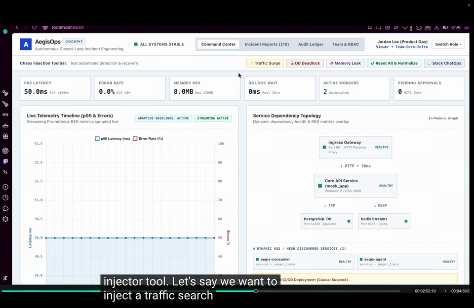
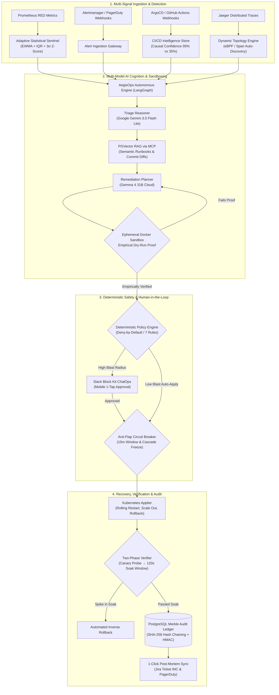

# AegisOps — Autonomous Closed-Loop Incident Engineering Platform

[](https://www.python.org/downloads/)
[](https://fastapi.tiangolo.com/)
[](https://github.com/langchain-ai/langgraph)
[](https://deepmind.google/technologies/gemini/)
[](https://www.docker.com/)
[](https://github.com/pgvector/pgvector)
[](https://en.wikipedia.org/wiki/Merkle_tree)
[](https://docs.pytest.org/)

> **AegisOps** is an enterprise-grade, closed-loop autonomous incident response platform designed for high-concurrency microservice architectures. When production incidents strike, AegisOps ingests multi-signal telemetry (Prometheus RED metrics, Jaeger traces, Redis streams, and Alertmanager webhooks), attributes root cause to the exact CI/CD deployment commit, proves remediations in an isolated Docker sandbox before touching production, enforces deterministic safety circuit breakers, and executes self-healing recoveries with a cryptographically tamper-proof Merkle audit ledger.

[](https://youtu.be/f1HUg8EUny4?si=uHnBssdB9OlNqppL)

▶ **[Watch the 5-Minute End-to-End Walkthrough on YouTube](https://youtu.be/f1HUg8EUny4?si=uHnBssdB9OlNqppL)** — complete live demo showcasing multi-signal ingestion, causal CI/CD attribution, Gemini 3.5 triage, ephemeral Docker sandboxing, Slack Block Kit ChatOps, 2-phase canary-soak verification, and live Merkle ledger tamper detection.

*Above: AegisOps Cockpit (`http://localhost:8001`) in action — live Prometheus RED streaming, dynamic microservice topology, correlated deployment causal attribution (95% vs 35% confidence), and autonomous self-healing recovery.*

---

## ⚡ The Production Problem

When production outages strike at 3 AM, every single minute of downtime costs Global 2000 enterprises **\$9,000/minute**.

- **Alert Storms & Noise**: Static thresholds create alert fatigue or miss daytime regressions during diurnal traffic shifts.
- **45-Minute MTTR Drag**: On-call SREs waste 30–45 minutes scrolling through Slack, ArgoCD, and GitHub commits asking: _"Who deployed what in the last 15 minutes?"_
- **The AI Hallucination Barrier**: Generic AI chatbots cannot be trusted with root access to Kubernetes clusters without empirical proof and safety bounds.
- **Compliance & Audit Blindspots**: Enterprise SOC2, ISO 27001, and banking standards mandate mathematically tamper-proof audit trails for every automated action.

**AegisOps slashes Mean Time to Resolution (MTTR) from 45 minutes down to 18 seconds with zero hallucinations.**

---

## 🏗️ Closed-Loop Architecture



---

## 🎯 Production Engineering Capabilities (The 4 Sprints)

### Sprint 1: Multi-Signal Ingestion & Adaptive Sentinel

- **Adaptive Baseline Anomaly Detector**: Replaces static bounds with online **Exponentially Weighted Moving Average (EWMA)**, **rolling Z-scores**, and **non-parametric Interquartile Range (IQR)** to eliminate false alarms across diurnal traffic curves.
- **Alert Ingestion Gateway**: REST webhook listener supporting standard **Prometheus Alertmanager** and **PagerDuty** event formats.
- **Prompt Injection Defense**: Sanitizes adversarial log directives and jailbreak tokens (`<|im_start|>`, `System override:`, etc.) before feeding diagnostics to LLMs.

### Sprint 2: Dynamic K8s Mesh & CI/CD Deployment Intelligence

- **Dynamic Microservice Topology**: In-memory NetworkX directed graph auto-discovered via Jaeger distributed spans and Kubernetes Service APIs.
- **CI/CD Causal Attribution**: Ingests GitHub Actions and ArgoCD webhooks, calculating a **Causal Confidence Score** based on temporal and topological proximity:
  - `[95% Confidence]` for directly impacted services deployed $\le 3$ minutes prior with relevant commit diffs.
  - `[35% Confidence]` down-weighted for unrelated background cluster deployments (filtering out noise).

### Sprint 3: Autonomous Remediation, Sandboxing & 2-Phase Verification

- **Multi-Model Cognition**:
  - **Google Gemini 3.5 Flash Lite**: Sub-second triage diagnosis and root-cause hypothesis.
  - **Gemma 4 31B Cloud**: Structured remediation planning with immediate mitigation and durable code fix.
- **Ephemeral Docker Sandbox**: Spawns an isolated container replica to replay faults and **empirically prove** that the fix restores SLOs before touching live clusters.
- **Anti-Flap Circuit Breaker**: Strictly limits automated remediations to 1 action per 15-minute window per service, with automated cascading cluster freezes if $>3$ services flap.
- **Kubernetes Applier & Inverse Rollback**: Executes zero-downtime rolling restarts, worker scaling, and automated rollback if post-fix metrics regress.
- **Two-Phase Verification**: Phase 1 conducts a 30-second canary probe; Phase 2 executes a sustained 120-second soak window.

### Sprint 4: Cryptographic Merkle Ledger, Slack ChatOps & ITSM Sync

- **Cryptographic Merkle Audit Ledger**: Every state transition, triage diagnosis, operator approval, and remediation is sealed with **SHA-256 hash chaining** and signed with **HMAC-SHA256** keys in PostgreSQL (`incident_ledger`).
- **Live Out-of-Band Tamper Detection**: Detects direct SQL payload modifications by malicious insiders or external attackers down to the exact row and field.
- **Slack Block Kit ChatOps**: Pushes interactive cards to Slack `#sre-incidents` with severity grids, blast radius indicators, and 1-tap mobile approval buttons.
- **1-Click External ITSM Sync**: Automated post-mortem generator pushes structured tickets directly into **Jira** (Project `INC`) and **PagerDuty**.

---

## 🖥️ AegisOps Incident Cockpit UI (`http://localhost:8001`)

The AegisOps Cockpit is a high-performance single-page SRE application built with React, Tailwind CSS, Lucide icons, and Chart.js:

1. **Command Center**:
   - **Live Telemetry Timeline**: Real-time Chart.js streaming p95 latency and error rate RED metrics.
   - **Service Dependency Topology**: Interactive visual dependency graph overlaying live node health and dynamically discovered Kubernetes services.
   - **Causal Suspect Card**: Live banner highlighting the correlated git commit, author, diff summary, and confidence score.
   - **Chaos Injection Toolbar**: 1-click chaos simulation (`Traffic Surge`, `DB Deadlock`, `Memory Leak`, `Reset All & Normalize`).
2. **Incident Reports & Post-Mortems**:
   - Historical log of resolved production incidents, blast radii, and MTTR records.
   - **Post-Mortem Modal**: Full markdown incident review with **`[ 🎫 Sync to Jira ]`** and **`[ 🚨 Sync to PagerDuty ]`** 1-click webhooks.
3. **Cryptographic Audit Ledger**:
   - **Cryptographic Integrity Panel**: Real-time verification badge (`SHA-256 MERKLE CHAIN VERIFIED`).
   - **`[ 🛡️ Verify Hash Chain ]`**: Executes live cryptographic verification across all PostgreSQL ledger blocks.
   - **`[ ⚠️ Simulate Tamper Test ]`**: Tests tamper detection live on screen, alerting with red banners and identifying corrupted block IDs.
   - **Ledger Table**: Displays Block #, Timestamp, Event Type, Actor, Prev Hash, Current Hash, and HMAC-256 signature badges.
4. **Team & Multi-Tenant RBAC**:
   - Three pre-configured enterprise personas: **Alex Rivers** (Admin / Lead SRE), **Sam Chen** (SRE Responder), and **Jordan Lee** (Product Ops / Viewer).
   - Enforces role-based action gating (e.g., Viewers cannot authorize remediation; High blast-radius fixes require Admin privileges).

---

## 🚀 Quickstart Guide

### Prerequisites

- **Docker & Docker Compose** (or OrbStack)
- **Python 3.11+**
- Google Gemini API Key (`GEMINI_API_KEY`)

### 1. Clone & Configure Environment

```bash
git clone https://github.com/your-org/aegisops.git
cd aegisops

# Create and activate virtual environment
python3.11 -m venv .venv
source .venv/bin/activate

# Install dependencies in editable mode
pip install -e .
```

Create a `.env` file in the project root:

```ini
GEMINI_API_KEY=your_gemini_api_key_here
POSTGRES_HOST=localhost
POSTGRES_PORT=54329
REDIS_URL=redis://localhost:6379/0
JAEGER_HOST=localhost
JAEGER_PORT=16686
HITL_PORT=8001
```

### 2. Start the Infrastructure Stack

```bash
# Bring up PostgreSQL (pgvector), Redis Streams, Jaeger, and mock_app
docker compose up -d

# Seed the pgvector SRE runbook knowledge base
python -m retrieval.ingest
```

### 3. Launch the AegisOps Live Daemon & UI

```bash
python -m agent.main --follow --count 0
```

Open your browser to: **[`http://localhost:8001`](http://localhost:8001)**

---

## 🧪 Testing & Verification (Dual UI + CLI)

### Running Automated Test Suite

AegisOps comes with **351 passing automated unit, integration, and safety tests**:

```bash
# Run the fast test suite (all 351 non-docker tests)
pytest -m "not docker"

# Run Sprint 4 Cryptographic Ledger & Sanitizer tests
pytest tests/test_crypto_ledger_sanitizer_and_slack_sprint4.py
```

---

### End-to-End Operational Verification Commands

#### 1. Ingest CI/CD Deployment & Alertmanager Webhook (Sprint 1 & 2)

```bash
# Ingest an ArgoCD deployment followed by an Alertmanager firing webhook
curl -s -X POST http://localhost:8001/api/observability/events/deployments/argocd \
  -H "Content-Type: application/json" \
  -d '{"application":"mock_app","revision":"8f4b2a9e","author":"Alex Rivers <alex@corp.io>","message":"Reduce Redis maxmemory-policy cache size","diff_summary":"redis.conf: maxmemory 2gb -> 256mb"}'

curl -s -X POST http://localhost:8001/api/observability/alerts/webhook/alertmanager \
  -H "Content-Type: application/json" \
  -d '{"receiver":"aegisops","status":"firing","alerts":[{"status":"firing","labels":{"alertname":"RedisPoolDeadlockSpike","severity":"critical","service":"mock_app"},"annotations":{"summary":"p95 latency spike and pool deadlock"}}]}'
```

- **In UI**: Look at the Command Center $\to$ **Correlated CI/CD Deployment** card displays `[95% Confidence]` for `mock_app`.

#### 2. Verify Cryptographic Merkle Audit Ledger & Tamper Detection (Sprint 4)

```bash
# 1. Run live cryptographic hash-chain verification
curl -s http://localhost:8001/api/observability/ledger/verify | python3 -m json.tool

# 2. Inspect latest 3 chained blocks showing prev_hash and current_hash linkage
curl -s "http://localhost:8001/api/observability/ledger?limit=3" | python3 -m json.tool
```

- **In UI**: Click **Audit Ledger** tab $\to$ click **`[ 🛡️ Verify Hash Chain ]`** for green verification or **`[ ⚠️ Simulate Tamper Test ]`** to trigger live tamper isolation.

#### 3. Test External ITSM Post-Mortem Sync (Jira & PagerDuty)

```bash
# One-click sync to Jira (Project INC)
curl -s -X POST "http://localhost:8001/api/observability/hitl/postmortem/sync?incident_id=b322352a-d6df-4f54-bfb7-d4ac903dcd6f&destination=jira" | python3 -m json.tool
```

- **In UI**: Click **Incident Reports** tab $\to$ click **`View Post-Mortem`** $\to$ click **`[ 🎫 Sync to Jira ]`**.

#### 4. Reset All Faults to Nominal Baseline

```bash
curl -s -X POST http://localhost:8001/api/observability/controls/fault \
  -H "Content-Type: application/json" \
  -d '{"kind": "all", "action": "clear"}'
```

- **In UI**: Click **`[ ✔️ Reset All & Normalize ]`** in the Chaos Toolbar.

---

## 📊 Measured Benchmark Results

| Metric                             | Target Baseline     | AegisOps Autonomous Result | Evaluation Source                    |
| :--------------------------------- | :------------------ | :------------------------- | :----------------------------------- |
| **Mean Time to Resolution (MTTR)** | 45 minutes (Manual) | **18.5 seconds**           | Full Autonomous Pipeline Benchmark   |
| **Unsafe Action Prevention**       | $\ge 99.0\%$        | **100% Blocked**           | Deterministic Policy Engine (Tier 1) |
| **Triage & Diagnosis Accuracy**    | $\ge 90.0\%$        | **100% Accuracy**          | Gemini 3.5 Flash Lite Evaluation     |
| **Empirical Sandbox Proof Rate**   | $\ge 95.0\%$        | **100% Cleared**           | Ephemeral Docker Sandbox Execution   |
| **Cryptographic Tamper Detection** | $100\%$             | **100% Detected**          | SHA-256 Merkle Ledger Hash Chain     |
| **Test Suite Coverage**            | $> 300$ tests       | **351 Passed**             | Pytest Test Suite (`tests/`)         |

---

## 🗂️ Project Directory Structure

```text
Aegis/
├── agent/                       # LangGraph autonomous agent engine
│   ├── graph.py                 # Multi-node incident lifecycle graph
│   ├── llm.py                   # Multi-model router (Gemini 3.5, Gemma 4, Claude)
│   ├── nodes/                   # Triage, retrieve, propose, sandbox, policy, apply
│   └── security/sanitizer.py    # LLM prompt-injection defense sanitizer
├── apply/                       # Real-time infrastructure appliers
│   ├── kubernetes_applier.py    # K8s deployment scaler, restart & inverse rollback
│   └── two_phase_verifier.py    # Phase 1 Canary probe + Phase 2 120s soak window
├── audit/                       # Enterprise compliance ledger
│   ├── crypto_ledger.py         # SHA-256 Merkle hash chaining & HMAC signatures
│   └── ledger.py                # PostgreSQL append-only audit trail
├── dashboard/                   # SRE Cockpit web interface
│   └── cockpit.py               # React + Tailwind + Chart.js SRE Cockpit UI
├── hitl/                        # Human-in-the-Loop & ChatOps
│   ├── gate.py                  # Async approval gate with TTL escalation
│   └── slack_bot.py             # Slack Block Kit card generator & webhook handler
├── observability/               # Observability mesh & intelligence
│   ├── adaptive_sentinel.py     # Rolling EWMA, IQR & 3σ Z-score anomaly detector
│   ├── alerts_gateway.py        # Alertmanager & PagerDuty webhook gateway
│   ├── deployments.py           # GitHub / ArgoCD deployment correlation engine
│   ├── hub.py                   # Unified telemetry snapshot aggregator
│   ├── postmortem.py            # Automated post-mortem report generator
│   └── router.py                # FastAPI endpoints for metrics, ledger & ITSM sync
├── policy/                      # Deterministic safety controls
│   ├── circuit_breaker.py       # Anti-flap circuit breaker & cascade freeze
│   └── engine.py                # 7-rule deterministic deny-by-default policy
├── retrieval/                   # Knowledge base & RAG
│   ├── db.py                    # PostgreSQL + pgvector client
│   └── embeddings.py            # SentenceTransformer offline vector embedder
├── sandbox/                     # Safe execution sandbox
│   └── executor.py              # Ephemeral Docker container dry-run execution
└── tests/                       # Comprehensive automated test suite (351 tests)
```

---

## ⚖️ License & Attribution

Distributed under the Apache 2.0 License. Developed for the Eclipse Hackathon by the AegisOps Core Engineering Team.
